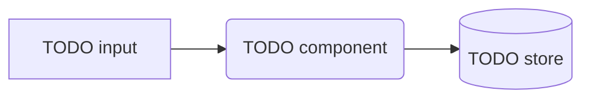

<!-- README skeleton. Follow docs/ai/readme-guidance.md, replace every TODO, delete sections that do not apply,
     then copy this over the repo-root README.md. Run the checklist in readme-guidance.md §7 before committing. -->

# TODO Project Name

TODO: one sentence — what it is and who it is for, in plain words.

<!-- Badges: replace OWNER/REPO. CI badge from GitHub Actions; add version/licence badges via shields.io -->
[](https://github.com/OWNER/REPO/actions/workflows/ci.yml)
[](LICENSE)

<!-- Hero: a screenshot, short recording or diagram showing it working. Descriptive alt text. -->


## Why

TODO: the problem it solves and how it differs from alternatives (2–4 sentences).

## Features

- **TODO capability:** why it matters
- **TODO capability:** why it matters

## Quickstart

```bash
# TODO: the smallest command or snippet that works as pasted
```

## Installation

**Prerequisites:** TODO (e.g. Python ≥ 3.11, Node ≥ 20, Docker)

```bash
# TODO: install commands
```

## Configuration

| Name | Type | Default | Description |
| --- | --- | --- | --- |
| `TODO_VAR` | string | `""` | TODO |

<details>
<summary><b>All options</b></summary>

TODO: full option list, if long.

</details>

## How it works



## Status

TODO: alpha / beta / production, and what is next.

## Development

```bash
# TODO: run tests locally
```

## License

TODO: SPDX name — see [LICENSE](LICENSE). Third-party licences: TODO.
